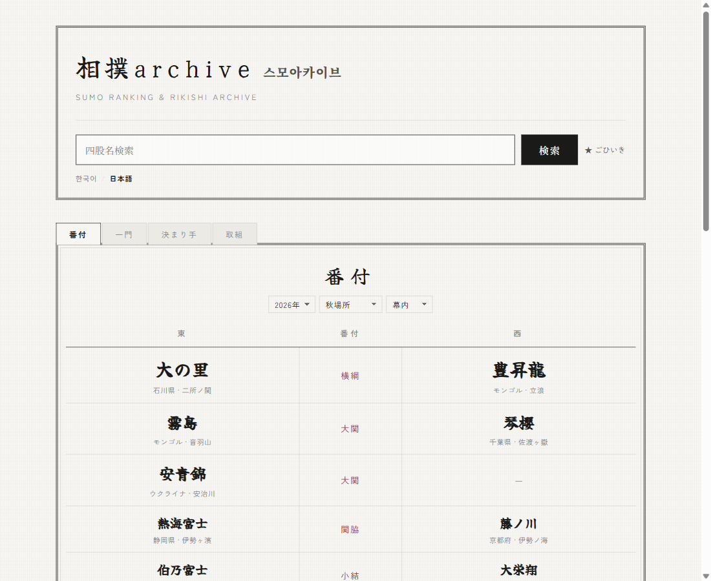
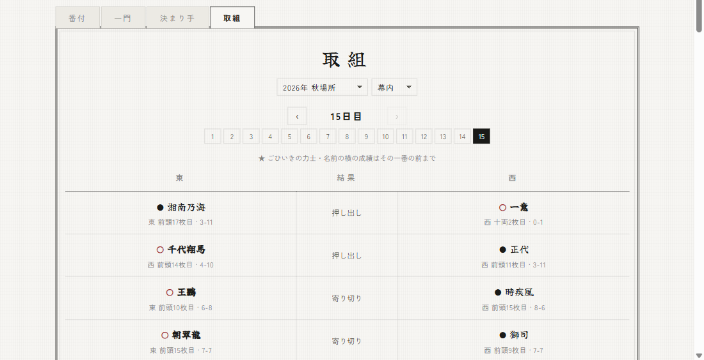
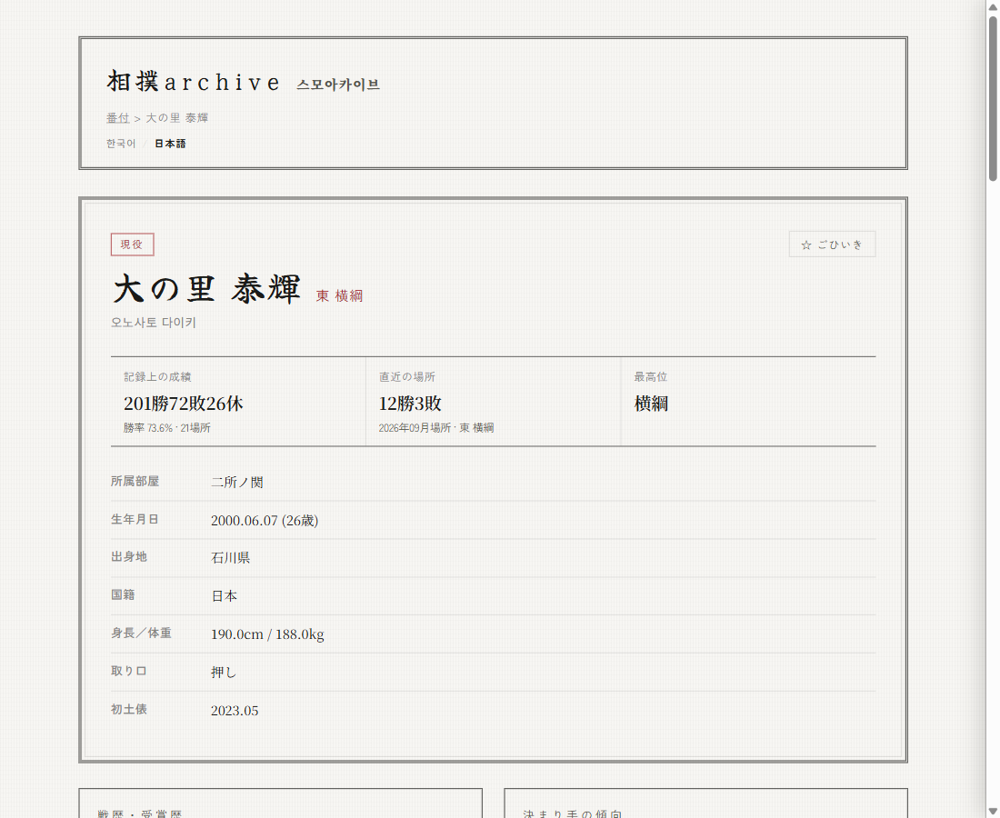
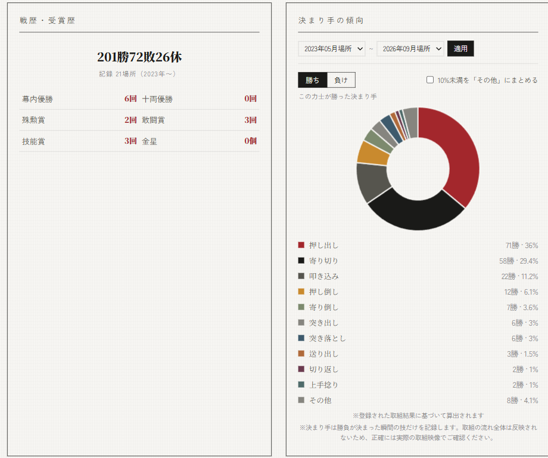
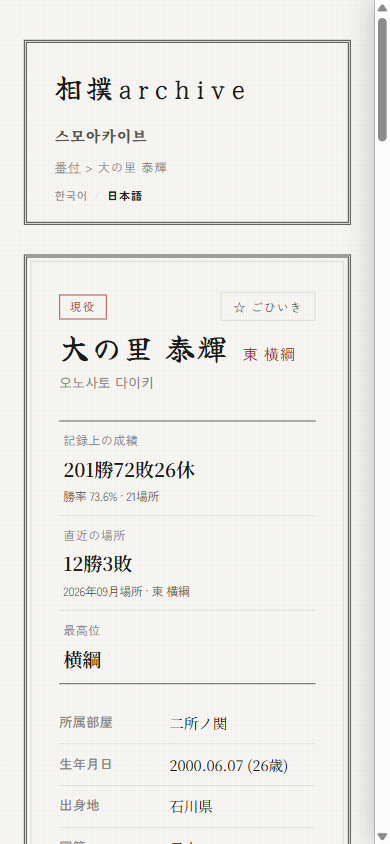
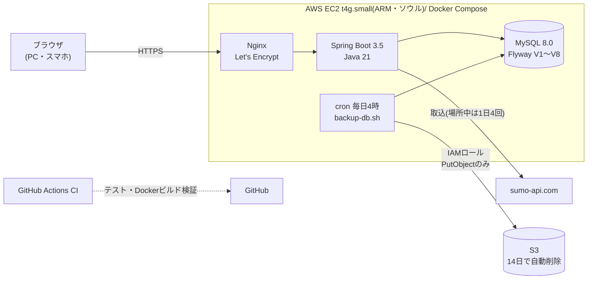
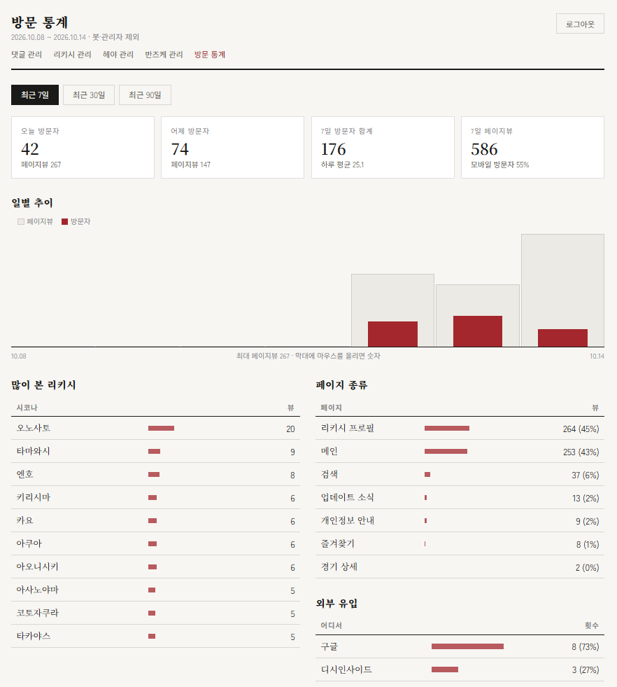

# 🏯 sumoarchive — 相撲アーカイブ

[](https://github.com/genuinekumquat/sumoarchive/actions/workflows/ci.yml)

[한국어](README.md) | **日本語**

**大相撲の番付・力士・取組を、韓国語と日本語で調べられるアーカイブサービスです。**

🔗 **https://sumoarchive.com** (2026年10月公開・運用中)

韓国出身の開発者として、「日本語の資料しかなくて韓国のファンには敷居が高い大相撲を、韓国語でも楽しめるようにしたい」という思いから作りました。
画面・データ・URLはすべて日韓2言語に対応しています。企画・設計から実装、AWSでの運用まで一人で担当しています。

| | |
|---|---|
|  |  |
| **番付** — 年・場所・各段を選んで表示 | **取組** — 日ごとの結果と、前日に発表された翌日の取組 |
|  |  |
| **力士プロフィール** — 成績・次の取組・星取表 | **分析** — 決まり手の傾向、負け方の分析、相手別の成績 |

<p align="center"></p>

### 数字で見る

| 項目 | 内容 |
|---|---|
| データ | 取組 **106,534件**・力士 **1,157人**・**46場所**(2019年〜)・幕内〜序ノ口の **全6階級** |
| テスト | JUnit 5 + Mockito **110件**、GitHub Actions で毎回実行(空のDBから Flyway + 全テスト) |
| 運用 | AWS EC2 + Docker Compose、毎日 S3 バックアップ、場所中は取組結果を **1日4回自動取込** |
| 利用 | 韓国の相撲コミュニティでの紹介をきっかけに、10月12〜14日の3日間で延べ **176人** が訪問(管理画面の統計、[4-3](#4-3-個人情報を保存しないアクセス統計)) |
| 開発 | 2026年7月 設計開始 → 9月 実装 → 10月10日 公開(作業記録は Notion に42回分) |

---

## 目次

1. [主な機能](#1-主な機能)
2. [アーキテクチャ](#2-アーキテクチャ)
3. [技術スタック](#3-技術スタック)
4. [設計と課題解決](#4-設計と課題解決) ← いちばん見ていただきたい部分です
5. [運用](#5-運用)
6. [ローカルでの実行方法](#6-ローカルでの実行方法)
7. [ドキュメント](#7-ドキュメント)

---

## 1. 主な機能

**利用者向け(ログイン不要)**

- **番付** — 年・場所・階級(幕内〜序ノ口)を選んで表示。番付の各段の一枚目は「前頭筆頭」のように表記
- **取組** — 日ごとの取組結果(勝敗・決まり手)と、前日に発表された翌日の取組。各力士の「その一番の前までの成績」も表示
- **力士プロフィール** — 基本情報、記録上の成績、次の取組、星取表(取組をクリックするとスライドパネルで詳細)、対戦成績
- **分析** — 決まり手の勝ち/負けの割合、負け方の分析(同じ階級の平均と比べた弱点・強み)、相手の地位・体格別の成績、特に勝ち越し・負け越している相手
- **検索** — 韓国語・日本語の四股名、改名前の四股名までまとめて検索
- **ごひいき(お気に入り)** — ブラウザ(localStorage)だけに保存。今場所の番付・成績・直近の取組・次の取組をまとめて表示
- **取組ページのコメント** — 匿名・4桁の暗証番号で投稿/削除、通報
- **決まり手事典** — 日本相撲協会の公式八十二手+非技を分類して解説
- **更新情報**(`/updates`)・**個人情報の取り扱い**(`/privacy`)

**管理者向け**

- sumo-api.com からの取込(力士名簿・場所・番付・取組・優勝/三賞/金星)、場所中の自動取込の状況確認
- 番付・取組・力士・部屋の手動修正、韓国語の四股名の確認
- コメント管理(通報されたコメントの確認・非表示)
- アクセス統計(日別の訪問者・PV、よく見られた力士、参照元)

画面と API の一覧は [docs/api.ja.md](docs/api.ja.md)、利用シナリオは [docs/scenarios.ja.md](docs/scenarios.ja.md) にあります。

---

## 2. アーキテクチャ



- **DNS**: Cloudflare(プロキシなし。IPベースのレート制限が実際の接続元を見られるように)
- **データの流れ**: sumo-api.com → 取込サービス(upsert、何度実行しても安全)→ MySQL → 画面。結果が出た取組は `torikumi`、発表のみの取組は `scheduled_bout` に分けて保存
- **画面**: Thymeleaf のサーバーサイドレンダリングが基本。番付・取組・ごひいきなど切り替えが多い部分だけ fetch + JSON API

---

## 3. 技術スタック

| 区分 | 技術 |
|---|---|
| 言語・FW | Java 21, Spring Boot 3.5 (MVC, Data JPA, Cache, Scheduling) |
| DB | MySQL 8.0, Flyway |
| 画面 | Thymeleaf, Vanilla JS, Chart.js |
| 国際化 | Spring MessageSource(`messages.properties` / `messages_ja.properties`) |
| 認証 | Spring Security 不使用 — セッション + インターセプター + 独自 CSRF トークン |
| テスト | JUnit 5, Mockito, AssertJ, `@WebMvcTest` |
| インフラ | AWS(EC2 Graviton, S3, IAM), Docker Compose, Nginx, Let's Encrypt, Cloudflare DNS |
| CI | GitHub Actions(MySQL サービスコンテナ、Docker ビルド、compose 検証) |

---

## 4. 設計と課題解決

実際に起きた問題と、その原因・選択肢・結果をまとめました。詳細は各コミットにあります。

### 4-1. 力士プロフィールの N+1:1回の表示でクエリ64〜94回 → 23回に固定
- **問題**: 力士プロフィールの表示に、場所が11場所分しかない段階でもクエリが64〜94回。過去データを入れるほど場所数に比例して増える構造でした。
- **原因**: 星取表を作る際、場所ごとに「本人の取組」「相手の番付」「最終取込日」「全休判定」を別々に照会していた(`show-sql` のログを集計して特定)。
- **対応**: 通算の取組を1回で取得してメモリで場所ごとにグループ化、相手の番付は `IN` 句1回、取込済みの日は `MAX(day)` の集計1回にまとめ、`JOIN FETCH` で遅延ロードを除去。
- **結果**: 場所数に関係なく **23回で固定**。変更前後で4人 × 日韓の8ページの HTML が完全に一致することを確認してから反映。([d091da9](https://github.com/genuinekumquat/sumoarchive/commit/d091da9))

### 4-2. 発表済みの取組を、統計を汚さずに保存する
- **問題**: 取組は前日に発表されますが(初日・二日目は開催2日前)、取込は「結果のある取組」だけを保存していたため、「次の取組」を表示できませんでした。
- **検討**: 既存の `torikumi` テーブルに「勝者なし」の行として入れる案は、星取表・勝率・相性・金星の計算がすべて「勝者がいる」前提のため、あちこちで除外漏れが起きる危険がありました。
- **対応**: 予定の取組だけを持つ **`scheduled_bout` テーブルを別に作成**(Flyway V6)。階級ごとの取込のたびに同期し、結果が出たもの・変更されたものは削除。**照会に失敗した日がある場合は削除をスキップ**して、誤って消さないようにしました。自動取込の期間も開催2日前からに拡大。
- **結果**: 既存の統計には一切手を入れずに、プロフィール・ごひいき・取組タブに「次の取組」を表示。([01ecd5e](https://github.com/genuinekumquat/sumoarchive/commit/01ecd5e), [db714dd](https://github.com/genuinekumquat/sumoarchive/commit/db714dd))

### 4-3. 個人情報を保存しないアクセス統計
- **問題**: 公開後、訪問者数を見るにはサーバーで Nginx のログを手作業で集計するしかありませんでした。
- **検討**: 外部の解析ツール(JSスニペット)より、管理画面ですぐ見られて、データも自分のDBに残る自前実装を選択。ただし IP アドレスは保存したくない。
- **対応**:
  - ユニーク訪問者は「その日だけのランダム値 + IP + ブラウザ」の SHA-256 をメモリ上の Set でだけ数え、日付が変わると破棄。**DB には日別の合計値だけ**を保存。
  - リクエストごとに DB へ書かず、メモリで集計して **1分ごとに `INSERT … ON DUPLICATE KEY UPDATE` でまとめて加算**。バケットの入れ替えは読み書きロックで、書き込み失敗時は次回に再加算。
  - ボットは User-Agent に加え、`Accept-Language` ヘッダーがないリクエストも除外(Nginx ログの集計で深夜にも一定数残っていたもの)。
- **結果**: 7・30・90日の推移、よく見られた力士、参照元を管理画面で確認可能。個人情報の取り扱いページにも反映。([a738e24](https://github.com/genuinekumquat/sumoarchive/commit/a738e24))

<p align="center"><br><sub>管理画面のアクセス統計(2026年10月14日時点の直近7日間。集計は10月12日から。管理画面は韓国語のみ)</sub></p>

### 4-4. IP 偽装によるレート制限の回避を防ぐ
- **問題**: コメント連投や管理者ログインの総当たりを IP 単位で制限していましたが、`X-Forwarded-For` ヘッダーの先頭の値をそのまま信じていたため、リクエストごとに値を変えれば制限を回避できました。
- **対応**: ヘッダーを直接読むのをやめ、`server.forward-headers-strategy=native`(Tomcat RemoteIpValve)で、**直前の接続が信頼できるプロキシ(Nginx)のときだけ**実際のIPに置き換えるように変更。あわせて管理者ログイン時のセッション再発行と CSRF トークンを追加。([32ee4df](https://github.com/genuinekumquat/sumoarchive/commit/32ee4df))

### 4-5. 利用者からの指摘を、公式資料との照合で直す
- **問題**: 公開翌日、コミュニティで「決まり手事典に、決まり手ではない『はず押し』が入っているのはなぜか」という指摘。
- **原因**: 辞書を作るとき、日本相撲協会の公式一覧と照合していなかった。調べると公式の決まり手33手が抜けており、実際の取組に出ていた26手がローマ字のまま表示されていました。
- **対応**: 協会の公式八十二手+非技と1件ずつ照合して辞書を作り直し、解説90件もすべて協会の解説と照らし合わせて修正。**分類ごとの件数(7/13/18/6/19/19)をテストで固定**し、今後ずれたらテストが落ちるようにしました。
- **結果**: 実際の取組記録には影響がないこと(該当0件)も確認して、指摘してくれた方に回答。([1156830](https://github.com/genuinekumquat/sumoarchive/commit/1156830), [4dc826c](https://github.com/genuinekumquat/sumoarchive/commit/4dc826c))

### 4-6. 本番運用を「手作業に頼らない」形にする
- **バックアップ**: 毎日4時に DB をダンプして S3 へ。EC2 の IAM ロールは **そのフォルダへの PutObject だけ**を許可(一覧・削除はできないことを確認)し、サーバーが乗っ取られてもバックアップは消せない構成。S3 のライフサイクルは個人情報の取り扱いページの記載(14日)と一致させています。
- **場所中の自動取込**: 18:30・20:00・22:00・翌朝9:00 に、開催2日前〜千秋楽の翌日の場所だけを自動取込。前回の実行中なら飛ばし、失敗しても次の回は動き、結果は管理画面に表示。([25e1eb3](https://github.com/genuinekumquat/sumoarchive/commit/25e1eb3))
- **デプロイ**: バックアップ → `git pull` → `docker compose up -d --build`。SSH が切れてもビルドが止まらないよう、サーバー側でバックグラウンド実行。手順は [DEPLOYMENT.md](DEPLOYMENT.md) にまとめています。

---

## 5. 運用

| 項目 | 内容 |
|---|---|
| サーバー | AWS EC2 t4g.small(2 vCPU・2GB、Ubuntu 24.04)、Elastic IP、セキュリティグループで SSH を自宅IPのみに制限 |
| HTTPS | Nginx + Let's Encrypt(自動更新)、www → 正規ドメインへ 301 |
| バックアップ | 毎日 DB ダンプ → サーバー内 + S3(14日保管) |
| ログ | アプリログ 14日・500MB 上限、Nginx アクセスログ 14日、docker logs サイズ制限 |
| 監視 | Actuator `/actuator/health`(DB接続込み)、Docker の healthcheck |
| 検索 | `robots.txt`・`sitemap.xml`(力士ページ日韓)、OGP |
| 費用 | 月18ドル前後(AWS の新規アカウントのクレジットで運用中) |

---

## 6. ローカルでの実行方法

```bash
# 1. MySQL にスキーマを作成(例: sumo)
CREATE DATABASE sumo CHARACTER SET utf8mb4;

# 2. ローカル設定ファイルを作成
cp src/main/resources/application-local.properties.example \
   src/main/resources/application-local.properties
# → DB アカウント、任意の管理者 ID/パスワードを入力

# 3. 実行(テーブルは Flyway が自動作成、データは空の状態で起動)
./gradlew bootRun

# 4. 管理者ログイン後、/admin/rikishi「ロスターインポート」→ /admin/basho の場所ごとの一括インポートでデータを投入
```

- 接続先: `http://localhost:8080`(ポートは `application-local.properties` の `server.port` で変更可)
- 管理者ログイン: `http://localhost:8080/admin/login`
- 秘密情報は `application-local.properties`(git 管理外)、本番は `.env` + 環境変数で管理しています

---

## 7. ドキュメント

- [docs/api.ja.md](docs/api.ja.md) — 画面・API 一覧
- [docs/scenarios.ja.md](docs/scenarios.ja.md) — 利用シナリオ
- [DEPLOYMENT.md](DEPLOYMENT.md) — 本番構築・デプロイ・バックアップ・場所ごとの運用手順(韓国語)
- [docs/erd.png](docs/erd.png)、[docs/sumoarchive_db_schema.sql](docs/sumoarchive_db_schema.sql) — DB 設計(初期版。現在のスキーマは `src/main/resources/db/migration`)
- [docs/기능명세서.txt](docs/기능명세서.txt) — 機能仕様書(韓国語)

**今後の予定**: 番付予測シミュレーター、2000〜2018年のデータ追加、検索エンジンへの登録

---

<sub>取組データ: [sumo-api.com](https://sumo-api.com)。個人が運営するファンサイトであり、日本相撲協会とは関係ありません。</sub>
