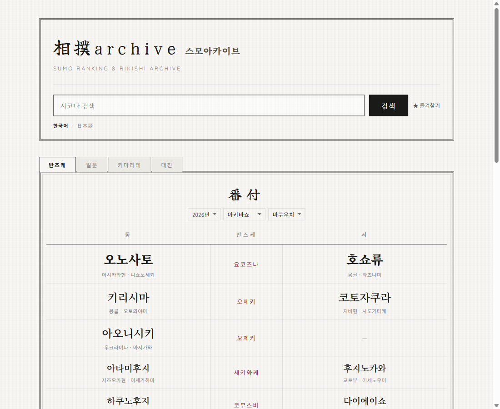
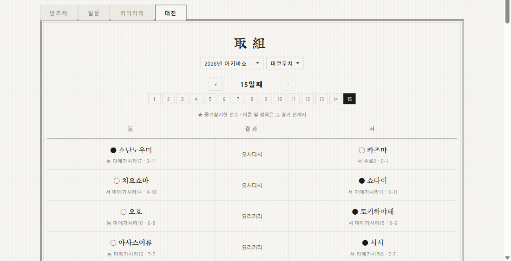
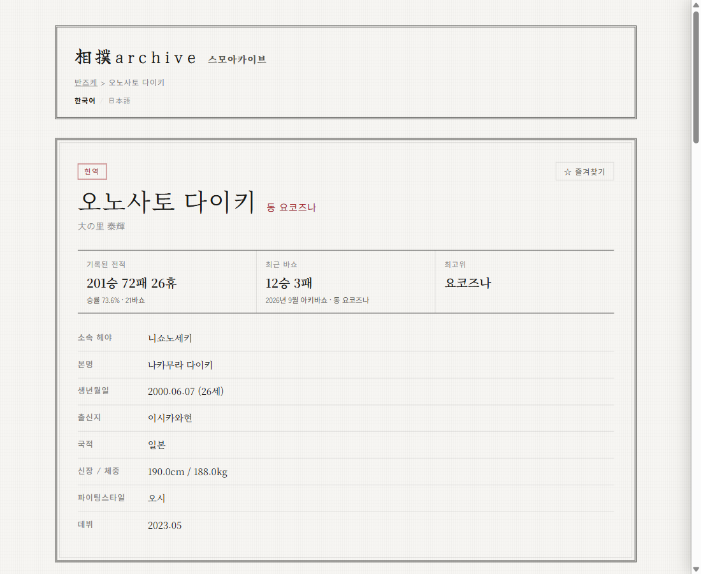
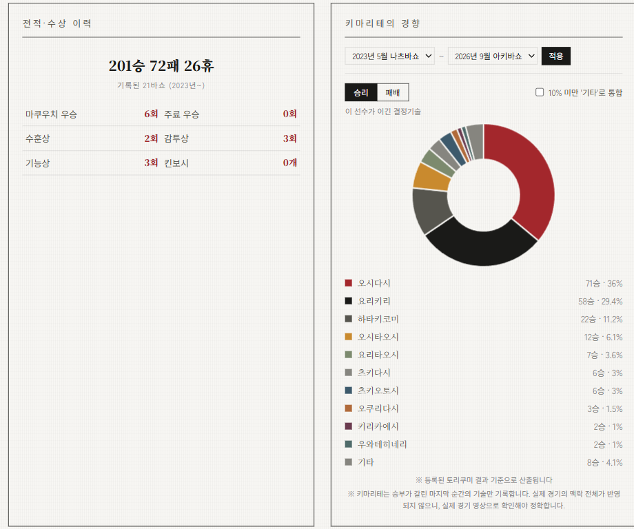
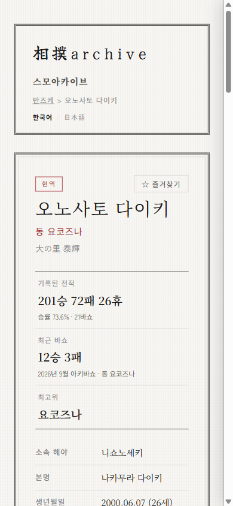
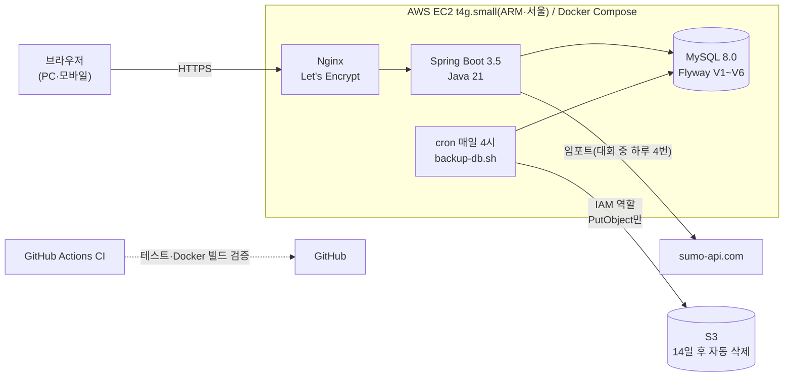

# 🏯 sumoarchive — 스모아카이브

[](https://github.com/genuinekumquat/sumoarchive/actions/workflows/ci.yml)

**한국어** | [日本語](README.ja.md)

**일본 오즈모(大相撲)의 반즈케·리키시·경기 결과를 한국어와 일본어로 찾아보는 아카이브 서비스입니다.**

🔗 **https://sumoarchive.com** (2026년 10월 공개 · 운영 중)

공식 정보 대부분이 일본어로만 나와 있어 한국 팬에게는 문턱이 높은 오즈모를, 한국어로도 편하게 즐길 수 있게 하려고 만들었습니다.
화면·데이터·주소 모두 한국어/일본어 두 언어를 지원하고, 기획·설계부터 구현, AWS 운영까지 혼자 맡고 있습니다.

| | |
|---|---|
|  |  |
| **반즈케** — 연도·대회·디비전을 골라서 보기 | **대진** — 날짜별 결과와 전날 발표된 다음 날 대진 |
|  |  |
| **리키시 프로필** — 성적·다음 경기·호시토리표 | **분석** — 결정기술 경향, 패배 유형, 상대 조건별 성적 |

<p align="center"></p>

### 숫자로 보기

| 항목 | 내용 |
|---|---|
| 데이터 | 경기 **106,534건** · 리키시 **1,157명** · **46바쇼**(2019년~) · 마쿠우치~조노구치 **6개 디비전 전부** |
| 테스트 | JUnit 5 + Mockito **110개**, GitHub Actions에서 매번 실행 (빈 DB에서 Flyway + 전체 테스트) |
| 운영 | AWS EC2 + Docker Compose, 매일 S3 백업, 대회 기간에는 경기 결과를 **하루 4번 자동 반영** |
| 사용 | 한국 스모 커뮤니티 소개를 계기로 10월 12~14일 3일간 누적 **176명** 방문 (관리자 통계, [4-3](#4-3-개인정보를-저장하지-않는-방문-통계)) |
| 개발 | 2026년 7월 설계 시작 → 9월 구현 → 10월 10일 공개 (노션 작업일지 42편) |

---

## 목차

1. [주요 기능](#1-주요-기능)
2. [아키텍처](#2-아키텍처)
3. [기술 스택](#3-기술-스택)
4. [설계와 문제 해결](#4-설계와-문제-해결) ← 가장 보여드리고 싶은 부분입니다
5. [운영](#5-운영)
6. [로컬 실행 방법](#6-로컬-실행-방법)
7. [문서](#7-문서)

---

## 1. 주요 기능

**이용자 (로그인 없음)**

- **반즈케** — 연도·대회·디비전(마쿠우치~조노구치)을 골라서 보기. 각 계급 1번은 「마에가시라필두」처럼 표기
- **대진** — 날짜별 경기 결과(승패·결정기술)와 전날 발표된 다음 날 대진. 선수 옆에 「그 경기 전까지의 성적」 표시
- **리키시 프로필** — 기본 정보, 기록된 전적, 다음 경기, 호시토리표(경기를 누르면 슬라이드 패널로 상세), 상대전적
- **분석** — 결정기술 승/패 비율, 패배 유형 분석(같은 계급 평균 대비 약점·강점), 상대 계급·체격별 성적, 유독 약한/강한 상대
- **검색** — 한국어·일본어 시코나, 바뀌기 전 시코나까지 통합 검색
- **즐겨찾기** — 브라우저(localStorage)에만 저장. 이번 바쇼 계급·성적·마지막 경기·다음 경기를 한눈에
- **경기 댓글** — 익명·숫자 4자리 비밀번호로 작성/삭제, 신고
- **키마리테 사전** — 일본스모협회 공식 82수 + 비기(非技)를 분류해서 해설
- **업데이트 소식**(`/updates`) · **개인정보 처리 안내**(`/privacy`)

**관리자**

- sumo-api.com 임포트(로스터·바쇼·반즈케·경기·우승/삼상/킨보시), 대회 중 자동 임포트 상태 확인
- 반즈케·경기·리키시·헤야 수동 수정, 한국어 시코나 검수
- 댓글 관리(신고 댓글 확인·가림)
- 방문 통계(일별 방문자·페이지뷰, 많이 본 리키시, 유입처)

화면·API 전체 목록은 [docs/api.md](docs/api.md), 사용 시나리오는 [docs/scenarios.md](docs/scenarios.md)에 있습니다.

---

## 2. 아키텍처



- **DNS**: Cloudflare (프록시 끔 — IP 기반 요청 제한이 실제 접속 IP를 보도록)
- **데이터 흐름**: sumo-api.com → 임포트 서비스(upsert라 여러 번 돌려도 안전) → MySQL → 화면. 결과가 나온 경기는 `torikumi`, 발표만 된 대진은 `scheduled_bout`에 따로 저장
- **화면**: Thymeleaf 서버 렌더링이 기본이고, 반즈케·대진·즐겨찾기처럼 자주 바꿔 보는 부분만 fetch + JSON API

---

## 3. 기술 스택

| 구분 | 기술 |
|---|---|
| 언어·프레임워크 | Java 21, Spring Boot 3.5 (MVC, Data JPA, Cache, Scheduling) |
| DB | MySQL 8.0, Flyway |
| 화면 | Thymeleaf, Vanilla JS, Chart.js |
| 다국어 | Spring MessageSource (`messages.properties` / `messages_ja.properties`) |
| 인증 | Spring Security 없이 세션 + 인터셉터 + 자체 CSRF 토큰 |
| 테스트 | JUnit 5, Mockito, AssertJ, `@WebMvcTest` |
| 인프라 | AWS (EC2 Graviton, S3, IAM), Docker Compose, Nginx, Let's Encrypt, Cloudflare DNS |
| CI | GitHub Actions (MySQL 서비스 컨테이너, Docker 빌드, compose 검증) |

---

## 4. 설계와 문제 해결

실제로 겪은 문제와 원인·선택·결과를 정리했습니다. 자세한 내용은 각 커밋에 있습니다.

### 4-1. 리키시 프로필 N+1: 한 번 조회에 쿼리 64~94번 → 23번 고정
- **문제**: 바쇼가 11개뿐인 시점에도 프로필 한 번에 쿼리가 64~94번. 과거 데이터를 넣을수록 바쇼 수에 비례해 늘어나는 구조였습니다.
- **원인**: 호시토리표를 만들 때 바쇼마다 「본인 경기」「상대 반즈케」「마지막 적재 일차」「전체 휴장 판정」을 따로 조회 (`show-sql` 로그를 세어서 확인).
- **대응**: 통산 경기를 한 번에 가져와 메모리에서 바쇼별로 묶고, 상대 반즈케는 `IN` 한 번, 적재 일차는 `MAX(day)` 집계 한 번, `JOIN FETCH`로 지연 로딩 제거.
- **결과**: 바쇼 수와 상관없이 **23번 고정**. 바꾸기 전후로 4명 × 한/일 8개 페이지 HTML이 완전히 같은지 확인한 뒤 반영. ([d091da9](https://github.com/genuinekumquat/sumoarchive/commit/d091da9))

### 4-2. 발표된 대진을 통계를 오염시키지 않고 저장하기
- **문제**: 대진은 전날 발표되는데(첫날·둘째 날은 개막 이틀 전), 임포트는 「결과가 있는 경기」만 저장해서 「다음 경기」를 보여줄 수 없었습니다.
- **검토**: 기존 `torikumi` 테이블에 「승자 없음」으로 넣는 방법은, 호시토리표·승률·상성·킨보시 계산이 전부 「승자가 있다」는 전제라 곳곳에서 걸러내다 빠뜨릴 위험이 컸습니다.
- **대응**: 예정 대진만 담는 **`scheduled_bout` 테이블을 따로 둠**(Flyway V6). 디비전 임포트마다 동기화해서 결과가 나왔거나 바뀐 대진은 지우고, **조회에 실패한 날이 있으면 지우기를 건너뛰어** 잘못 지우지 않게 했습니다. 자동 임포트 기간도 개막 이틀 전부터로 늘렸습니다.
- **결과**: 기존 통계는 전혀 건드리지 않고 프로필·즐겨찾기·대진 탭에 「다음 경기」를 표시. ([01ecd5e](https://github.com/genuinekumquat/sumoarchive/commit/01ecd5e), [db714dd](https://github.com/genuinekumquat/sumoarchive/commit/db714dd))

### 4-3. 개인정보를 저장하지 않는 방문 통계
- **문제**: 공개 후 방문자 수를 보려면 서버의 Nginx 로그를 직접 집계해야 했습니다.
- **검토**: 외부 분석 도구(JS 스니펫)보다, 관리자 화면에서 바로 보고 데이터도 우리 DB에 남는 직접 구현을 선택. 단, IP 주소는 저장하고 싶지 않았습니다.
- **대응**:
  - 순방문자는 「그날만 쓰는 랜덤 값 + IP + 브라우저」의 SHA-256을 메모리 Set에서만 세고 날짜가 바뀌면 버림. **DB에는 날짜별 합계만** 저장.
  - 요청마다 DB에 쓰지 않고 메모리에서 세다가 **1분마다 `INSERT … ON DUPLICATE KEY UPDATE`로 한 번에 더함**. 버킷 교체는 읽기/쓰기 잠금으로, 저장 실패 시 다음 회차에 다시 더함.
  - 봇은 User-Agent에 더해 `Accept-Language` 헤더가 없는 요청도 제외 (Nginx 로그 집계에서 새벽에도 꾸준히 남던 것들).
- **결과**: 7·30·90일 추이, 많이 본 리키시, 유입처를 관리자 화면에서 확인. 개인정보 처리 안내에도 반영. ([a738e24](https://github.com/genuinekumquat/sumoarchive/commit/a738e24))

<p align="center"><br><sub>관리자 방문 통계 화면 (2026년 10월 14일 기준 최근 7일, 집계는 10월 12일부터)</sub></p>

### 4-4. IP 위조로 요청 제한을 우회하는 문제 막기
- **문제**: 댓글 도배·관리자 로그인 무차별 대입을 IP 기준으로 제한했는데, `X-Forwarded-For` 헤더의 첫 값을 그대로 믿고 있어서 요청마다 값을 바꾸면 제한을 피할 수 있었습니다.
- **대응**: 헤더를 직접 읽지 않고 `server.forward-headers-strategy=native`(Tomcat RemoteIpValve)로, **직전 연결이 믿을 수 있는 프록시(Nginx)일 때만** 실제 IP로 바꾸도록 변경. 관리자 로그인 시 세션 교체와 CSRF 토큰도 추가. ([32ee4df](https://github.com/genuinekumquat/sumoarchive/commit/32ee4df))

### 4-5. 사용자 제보를 공식 자료와 대조해서 바로잡기
- **문제**: 공개 다음 날, 커뮤니티에서 「키마리테 사전에 결정기술이 아닌 『하즈오시』가 왜 있나요?」라는 제보.
- **원인**: 사전을 만들 때 일본스모협회 공식 목록과 대조하지 않았음. 확인해 보니 공식 결정기술 33개가 빠져 있었고, 실제 경기에 나온 26종이 로마자 그대로 표시되고 있었습니다.
- **대응**: 협회 공식 82수 + 비기와 한 줄씩 대조해 사전을 다시 만들고, 설명 90개도 전부 협회 해설과 대조해 수정. **분류별 개수(7/13/18/6/19/19)를 테스트로 고정**해서 앞으로 어긋나면 테스트가 깨지게 했습니다.
- **결과**: 실제 경기 기록에는 영향이 없다는 것(해당 0건)도 확인해서 제보자에게 답변. ([1156830](https://github.com/genuinekumquat/sumoarchive/commit/1156830), [4dc826c](https://github.com/genuinekumquat/sumoarchive/commit/4dc826c))

### 4-6. 운영을 「손으로 챙기지 않아도 되는」 구조로
- **백업**: 매일 4시에 DB를 덤프해 S3로. EC2의 IAM 역할은 **그 폴더에 PutObject만** 허용(목록·삭제가 안 되는 것 확인)해서 서버가 털려도 백업은 지울 수 없게 했습니다. S3 수명 주기는 개인정보 처리 안내에 적은 기간(14일)과 맞췄습니다.
- **대회 중 자동 임포트**: 18:30·20:00·22:00·다음 날 9:00에, 개막 이틀 전~종료 다음 날인 바쇼만 자동 임포트. 이전 실행이 아직 돌고 있으면 건너뛰고, 실패해도 다음 회차는 돌며, 결과는 관리자 화면에 표시. ([25e1eb3](https://github.com/genuinekumquat/sumoarchive/commit/25e1eb3))
- **배포**: 백업 → `git pull` → `docker compose up -d --build`. SSH가 끊겨도 빌드가 멈추지 않게 서버에서 백그라운드로 실행. 절차는 [DEPLOYMENT.md](DEPLOYMENT.md)에 정리했습니다.

---

## 5. 운영

| 항목 | 내용 |
|---|---|
| 서버 | AWS EC2 t4g.small (2 vCPU·2GB, Ubuntu 24.04), 탄력적 IP, 보안 그룹으로 SSH는 집 IP만 |
| HTTPS | Nginx + Let's Encrypt(자동 갱신), www → 정식 주소로 301 |
| 백업 | 매일 DB 덤프 → 서버 + S3 (14일 보관) |
| 로그 | 앱 로그 14일·500MB 상한, Nginx 접속 로그 14일, docker logs 크기 제한 |
| 상태 확인 | Actuator `/actuator/health`(DB 연결 포함), Docker healthcheck |
| 검색 | `robots.txt` · `sitemap.xml`(리키시 페이지 한/일), OG 태그 |
| 비용 | 월 18달러 안팎 (AWS 신규 계정 크레딧으로 운영 중) |

---

## 6. 로컬 실행 방법

```bash
# 1. MySQL에 스키마 생성 (예: sumo)
CREATE DATABASE sumo CHARACTER SET utf8mb4;

# 2. 로컬 설정 파일 생성
cp src/main/resources/application-local.properties.example \
   src/main/resources/application-local.properties
# → DB 계정, 원하는 관리자 아이디/비밀번호로 값 채우기

# 3. 실행 (테이블은 Flyway가 자동 생성, 데이터는 비어 있는 상태로 시작)
./gradlew bootRun

# 4. 관리자 로그인 후 /admin/rikishi "로스터 임포트" → /admin/basho 바쇼별 일괄 임포트로 데이터 채우기
```

- 접속: `http://localhost:8080` (포트는 `application-local.properties`의 `server.port`로 변경)
- 관리자 로그인: `http://localhost:8080/admin/login`
- 비밀 값은 `application-local.properties`(git 제외), 운영은 `.env` + 환경변수로 관리합니다

---

## 7. 문서

- [docs/api.md](docs/api.md) — 화면·API 목록
- [docs/scenarios.md](docs/scenarios.md) — 사용 시나리오
- [DEPLOYMENT.md](DEPLOYMENT.md) — 운영 서버 구성·배포·백업·바쇼별 운영 절차
- [docs/erd.png](docs/erd.png), [docs/sumoarchive_db_schema.sql](docs/sumoarchive_db_schema.sql) — DB 설계 (초기 버전. 현재 스키마는 `src/main/resources/db/migration`)
- [docs/기능명세서.txt](docs/기능명세서.txt) — 기능 명세

**다음 계획**: 반즈케 예측 시뮬레이터, 2000~2018년 데이터 추가, 검색엔진 등록

---

<sub>경기 기록 데이터: [sumo-api.com](https://sumo-api.com). 개인이 운영하는 팬 사이트이며 일본스모협회(日本相撲協会)와 관련이 없습니다.</sub>
